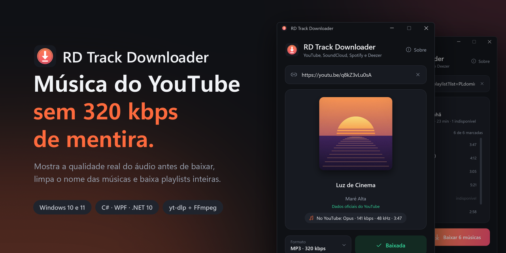
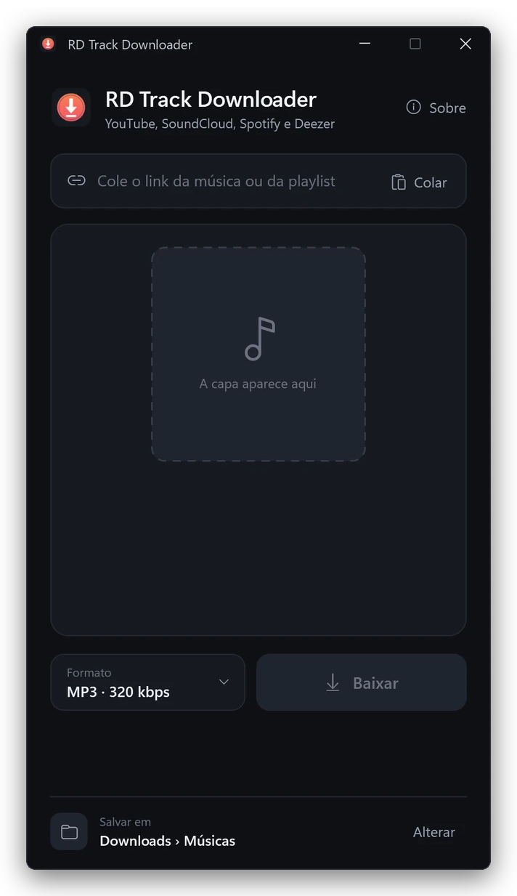
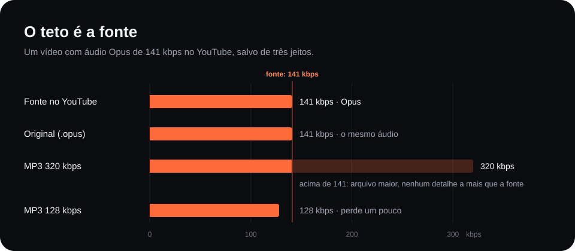
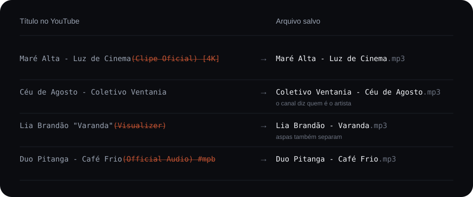
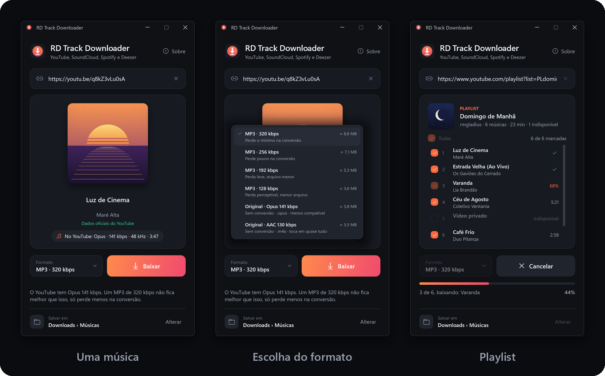
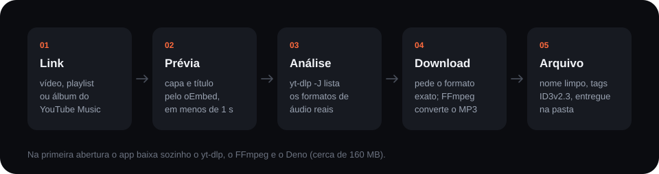

<p align="center">
  
</p>

<p align="center">
  <a href="https://github.com/rmgladius/rd-track-downloader/releases/latest"><b>Baixar para Windows</b></a>
  &nbsp;·&nbsp; Windows 10 e 11, 64 bits &nbsp;·&nbsp; não precisa instalar
</p>

RD Track Downloader é um app de Windows para baixar músicas e playlists do YouTube e do SoundCloud. Também aceita
links do Spotify e do Deezer (veja abaixo como). Antes do download ele mostra a qualidade real do
áudio, separa artista e música do título do vídeo e deixa escolher entre MP3 e o arquivo original,
sem conversão.

<p align="center">
  
</p>

## Sem 320 kbps de mentira

O YouTube guarda o áudio em Opus, em geral entre 130 e 160 kbps. Transformar isso em "MP3 320 kbps"
deixa o arquivo maior, não o som melhor. O app lê os formatos do vídeo antes de baixar, mostra o
número verdadeiro e diz o que cada opção faz com o áudio. Quem quer o máximo leva o original.

<p align="center">
  
</p>

## Nome de música, não de vídeo

<p align="center">
  
</p>

Quando o YouTube informa artista e faixa (YouTube Music e vídeos com a seção "Música"), esses dados
vêm primeiro. Sem eles, o nome sai do título e do canal. A tela diz de onde veio cada nome e deixa
corrigir antes de baixar. Artista, título, álbum e ano também vão para dentro do arquivo.

## Spotify, Deezer e SoundCloud

O SoundCloud entrega o áudio, e o app baixa direto de lá, faixas e sets. Faixas exclusivas do
SoundCloud Go+ aparecem como indisponíveis, porque fora da assinatura só 30 segundos são liberados.

O Spotify e o Deezer protegem o áudio, então o app não baixa deles. Do link ele lê nome, artistas,
álbum e capa, procura a mesma gravação no YouTube Music e baixa de lá. A busca confere nome, artista
e duração, usa o código ISRC quando o Deezer informa e recusa versão ao vivo, acústica, remix, cover ou
karaokê quando a original não é. Sem um resultado confiável, não baixa nada. A tela mostra qual
gravação foi achada e o arquivo sai com os dados e a capa oficiais. O som é o do YouTube Music, não o
do serviço de origem.

Fora do app, o Spotify mostra só as 100 primeiras faixas de uma playlist. Quando a lista é cortada,
a tela avisa.

## Telas

<p align="center">
  
</p>

Playlists e álbuns abrem como lista: dá para desmarcar faixas, cada uma mostra o próprio andamento e
uma falha não para a fila. Os arquivos vão para uma subpasta com o nome da playlist.

## Por dentro

<p align="center">
  
</p>

- O download pede ao yt-dlp o formato exato que a análise mostrou, então o número da tela é o do
  arquivo. No fim, o próprio yt-dlp informa o que baixou, e é isso que aparece em "Salva em…".
- "Original" nunca reconverte: o áudio é só copiado para `.opus` ou `.m4a`.
- O yt-dlp grava numa pasta interna e o app entrega o arquivo. Assim a proteção contra ransomware
  do Windows, que bloqueia programas novos em Músicas e Documentos, não atrapalha.
- Atualiza sozinho pelo GitHub Releases, conferindo o SHA-256 antes de trocar o executável.
- A lógica fica numa biblioteca separada da tela, com 215 testes, vários deles sobre respostas reais
  do YouTube Music, do Spotify, do Deezer e do SoundCloud. As imagens deste README saem do próprio app:
  `RDTrackDownloader.exe --demo` desenha cada quadro, com músicas e capas fictícias.

C# · WPF · .NET 10 · [yt-dlp](https://github.com/yt-dlp/yt-dlp) ·
[FFmpeg](https://ffmpeg.org) · [Deno](https://deno.com) · [TagLib#](https://github.com/mono/taglib-sharp)

## Rodar o código

Precisa do .NET 10 SDK.

```
dotnet test Faixa.slnx -c Release
dotnet run --project src/Faixa
```

Estrutura, decisões e como publicar uma versão: [docs/COMO-FUNCIONA.md](docs/COMO-FUNCIONA.md).

---

Feito por [Rodrigo Dias](https://github.com/rmgladius). Use o RD Track Downloader para baixar o que você tem direito de baixar.
